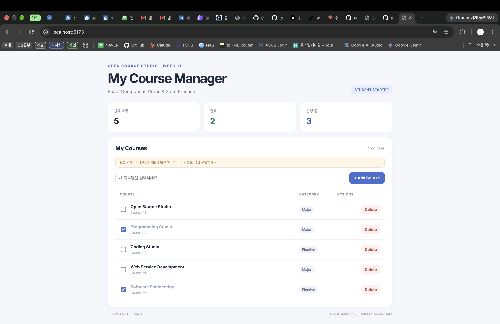
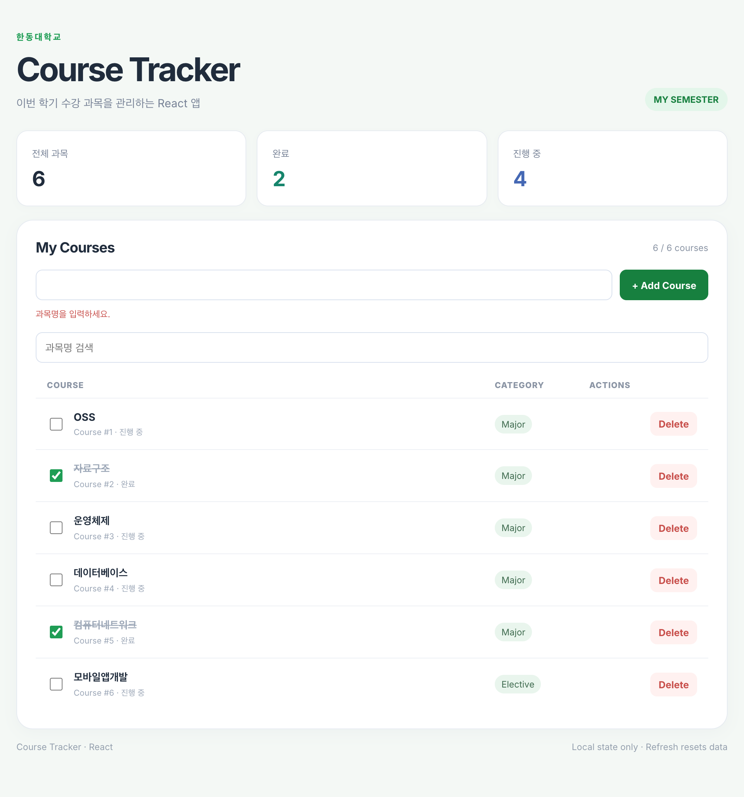
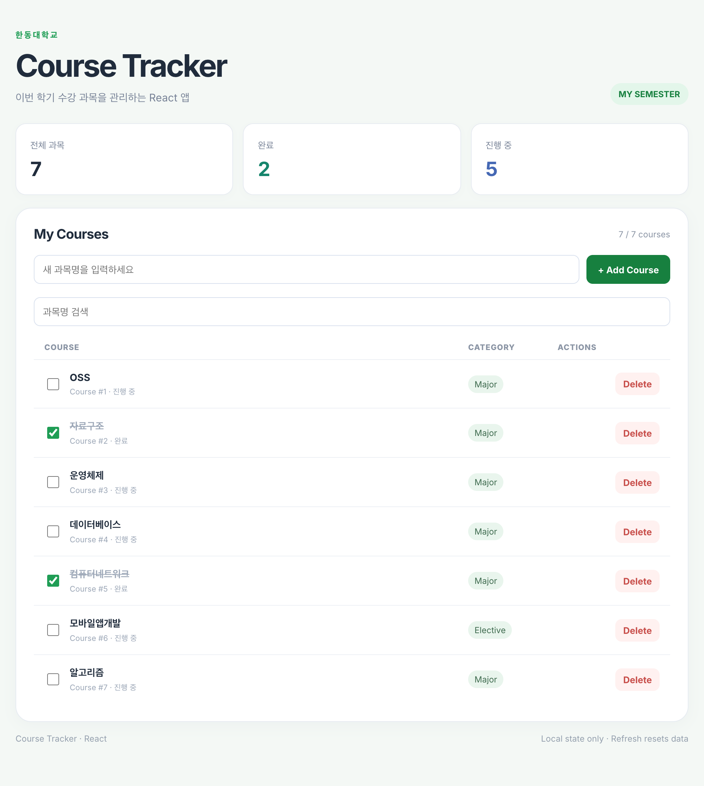
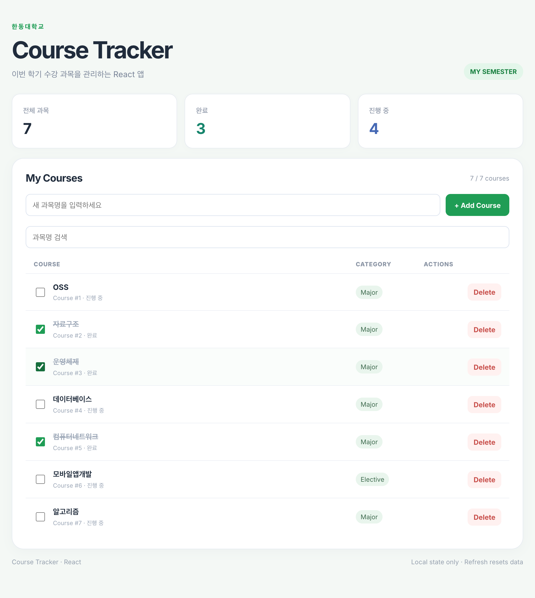
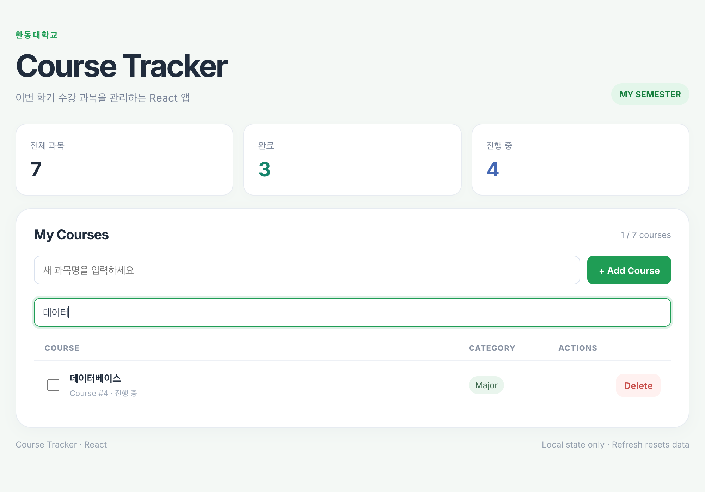
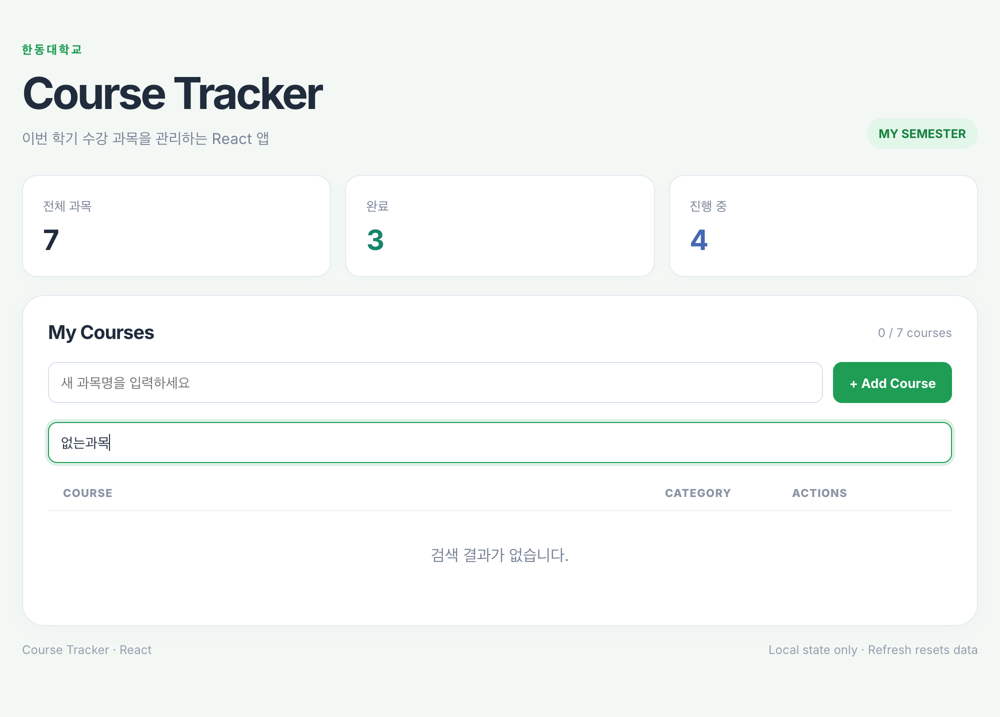

# Week 11

## Deployment
- **GitHub (조직)**: https://github.com/2026-2-OSS/assign11-c01-22300378
- **GitHub (개인)**: https://github.com/ggm77/2026OSS_assign11
- **Vercel URL**: https://2026-oss-assign11-mu.vercel.app/

## Project Information
- **프로젝트명**: Course Tracker
- **원본 Sample Project URL**: https://github.com/2026-2-OSS/week11_sample_project
- **설명**: 이번 학기 수강 과목을 추가, 조회, 삭제하고 완료 여부를 관리하는 React 앱이다. 과목명 검색 기능도 제공한다.
- **주요 기능**
  - 과목 조회 및 삭제
  - 과목 추가 (빈 문자열 등록 방지)
  - 체크박스를 이용한 완료/미완료 상태 변경
  - 과목명 검색
- 서버나 DB 없이 로컬 state만 사용하므로 새로고침하면 초기 데이터로 돌아간다.

## Installation
Node.js 20.19+ 또는 22.12+ 권장.

```bash
npm install
npm run dev
```

브라우저에 표시되는 Local URL에 접속하세요. 빌드 테스트: `npm run build`.

### 실행 화면


## Source Code Exploration

### Project Structure: 주요 파일 3개의 역할
- **App.jsx**: 헤더, 푸터 구현 및 과목 리스트 컴포넌트 불러오는 역할
- **CourseList.jsx**: 과목 추가, 조회, 삭제 기능을 제공하고 개별 과목 컴포넌트를 호출하는 역할
- **CourseItem.jsx**: 부모에게 받은 개별 과목 정보를 화면에 그리는 역할

### Component & Props: CourseList와 CourseItem의 관계 및 Props 전달 방식
CourseList가 부모, CourseItem이 자식이며, key와 course 통해 과목 정보를 넘기고, onDelete와 onToggle에 콜백 함수 정보를 넘겨서 자식 쪽에서 삭제와 토글 기능을 요청할 수 있게 한다.

### State & Event: useState를 이용한 상태 관리 및 삭제 버튼의 동작 원리
useState를 이용하여 컴포넌트 내에서 변수처럼 이용할 수 있으며, `const [newName, setNewName] = useState('');`로 선언 되어 있다면 newName을 통해 조회, setNewName()을 통해 값을 변경할 수 있다. 
삭제 버튼 자체는 자식 컴포넌트 쪽에 있으며, 기능 구현은 부모 컴포넌트에 되어있다. 이때 부모 컴포넌트 쪽에서 기능이 구현된 함수를 콜백 함수 형태로 자식에게 넘겨서 삭제 버튼이 동작할 수 있게한다. 자식이 부모에게 기능을 요청하는 것이다.

### Code Analysis: 주요 코드 2개(각 5~15줄)를 선택하여 동작 원리 설명
```jsx
// CourseList.jsx
{courses.map(course => (
    <CourseItem key={course.id} course={course} onDelete={handleDelete} onToggle={handleToggle} />
))}

// CourseItem.jsx
export default function CourseItem({ course, onDelete, onToggle }) {
  return (
    <div className="course-row">
      <div className="course-main">
        <input
          className="check"
          type="checkbox"
          checked={course.completed}
          onChange={() => onToggle(course.id)}
          aria-label={`${course.name} 완료 여부`}
        />
        // 생략
```
CourseList에서 CourseItem으로 props를 넘기고 CourseItem 쪽에서 받은 정보를 사용하는 코드이다. `key={course.id}`와 같은 형태로 데이터를 자식으로 넘기고, `onDelete={handleDelete}` 같은 형태로 콜백 함수를 넘긴다.

```jsx
// CourseList.jsx
const [courses, setCourses] = useState(initialCourses);

function handleDelete(id) {
  if (!window.confirm('이 과목을 삭제하시겠습니까?')) return;
  setCourses(previous => previous.filter(course => course.id !== id));
}

const doneCount = courses.filter(course => course.completed).length;
```
과목 목록을 state로 관리하고 삭제 기능을 구현한 코드이다. `useState(initialCourses)`로 초기 과목 배열을 state로 선언하고, `handleDelete`에서 `filter`를 통해 전달받은 id와 다른 과목만 남긴 새 배열을 만들어 `setCourses()`로 값을 변경한다. state가 변경되면 화면이 다시 그려지면서 `doneCount`도 새로 계산된다.


## Customizing
- **src/data/courses.js**: 초기 과목 데이터를 이번 학기 수강 과목 6개로 변경했다.
- **src/App.jsx, index.html**: 프로젝트 제목을 `Course Tracker`로 바꾸고, 설명과 상단 문구, 태그, 푸터, 브라우저 탭 제목을 변경했다.
- **src/App.css**: 다음과 같이 스타일을 변경했다.
  - 메인 색상을 파란색에서 초록색(`#1f9d55`)으로 변경 (상단 문구, Add 버튼, 태그, 체크박스, 입력창 포커스)
  - 페이지 배경, 과목 분류 태그 색상을 초록 계열로 변경
  - 패널의 `border-radius`를 18px에서 22px로 변경
  - 과목 행에 마우스를 올리면 배경색이 바뀌도록 hover 효과 추가

## Feature Extension
### Course Registration (Create)
```jsx
// CourseList.jsx
function handleAdd(event) {
  event.preventDefault();
  const name = newName.trim();
  if (name === '') {
    setError('과목명을 입력하세요.');
    return;
  }
  const newCourse = {
    id: courses.length === 0 ? 1 : Math.max(...courses.map(course => course.id)) + 1,
    name,
    category: 'Major',
    completed: false,
  };
  setCourses(previous => [...previous, newCourse]);
  setNewName('');
  setError('');
}
```
`handleAdd`에서 입력값을 `trim()`한 뒤 빈 문자열이면 에러 메시지를 띄우고 등록하지 않는다. 입력값이 있으면 기존 id 중 최댓값 + 1을 id로 하는 새 과목 객체를 만들어 `setCourses()`로 목록에 추가하고 입력창을 초기화한다.




### Course Completion (Update)
```jsx
// CourseList.jsx
function handleToggle(id) {
  setCourses(previous =>
    previous.map(course =>
      course.id === id ? { ...course, completed: !course.completed } : course
    )
  );
}

// CourseItem.jsx
<div className={`course-title ${course.completed ? "done" : ""}`}>
  {course.name}
</div>
<div className="course-id">
  Course #{course.id} · {course.completed ? "완료" : "진행 중"}
</div>
```
`handleToggle`에서 `map`과 spread(`...`)를 이용해 해당 id 과목의 `completed`만 반전시킨 새 배열을 만들어 `setCourses()`로 변경한다. 체크박스로 상태를 바꿀 수 있고, 완료된 과목은 취소선과 함께 `완료`로 표시된다.



### 과목명 검색 (선택 기능)
```jsx
// CourseList.jsx
const [query, setQuery] = useState('');

const searchedCourses = courses.filter(course =>
  course.name.toLowerCase().includes(query.trim().toLowerCase())
);

<input className="input" value={query} onChange={event => setQuery(event.target.value)} placeholder="과목명 검색" aria-label="과목명 검색" />
{courses.length > 0 && searchedCourses.length === 0 && <div className="empty">검색 결과가 없습니다.</div>}
{searchedCourses.map(course => (
  // 생략
))}
```
`query` state에 검색어를 저장하고, `filter`와 `includes`를 이용해 과목명에 검색어가 포함된 과목만 화면에 보여준다. 검색 결과가 없으면 안내 문구를 표시한다.




## Deployment
- **GitHub (조직)**: https://github.com/2026-2-OSS/assign11-c01-22300378
- **GitHub (개인)**: https://github.com/ggm77/2026OSS_assign11
- **Vercel URL**: https://2026-oss-assign11-mu.vercel.app/

## Weekly Review:
- **새롭게 배운 내용 3가지**
  1. 부모 컴포넌트가 state와 기능을 가지고, 자식 컴포넌트에게 props와 콜백 함수를 넘겨서 기능을 요청하게 하는 구조를 배웠다.
  2. state는 직접 수정하지 않고 `setCourses()`에 새 배열을 넘겨야 React가 변경을 감지하고 화면을 다시 그린다는 것을 배웠다.
  3. 배열을 다룰 때 추가는 spread, 수정은 `map`, 삭제와 검색은 `filter`를 사용하여 기존 배열을 바꾸지 않고 새 배열을 만드는 방법을 배웠다.
- **어려웠던 점과 해결 방법**
  - 완료 상태를 바꿀 때 해당 과목의 `completed`만 바꾸는 방법이 어려웠는데, `map`으로 id가 같은 과목만 `{ ...course, completed: !course.completed }`로 새로 만들고 나머지는 그대로 두는 방식으로 해결했다.
- **AI 활용 내용 및 느낀 점**
  - Claude Code를 사용하여 버그 수정을 했고, CSS 변경할 때 도움을 받았다. 내가 미처 확인하지 못한 부분까지 AI가 잡아줘서 신기했다.
  - 그외 나머지 개발은 전부 직접 진행하였다.